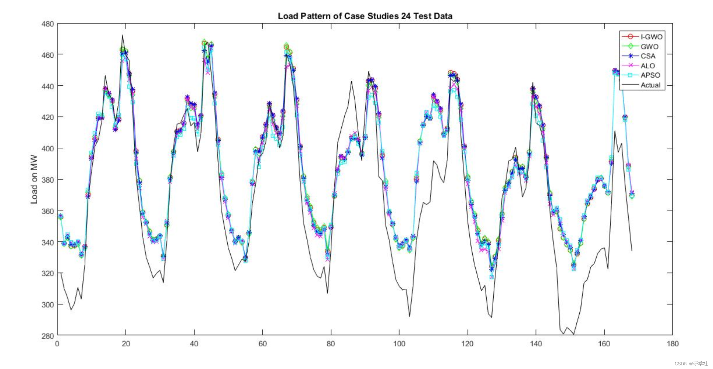
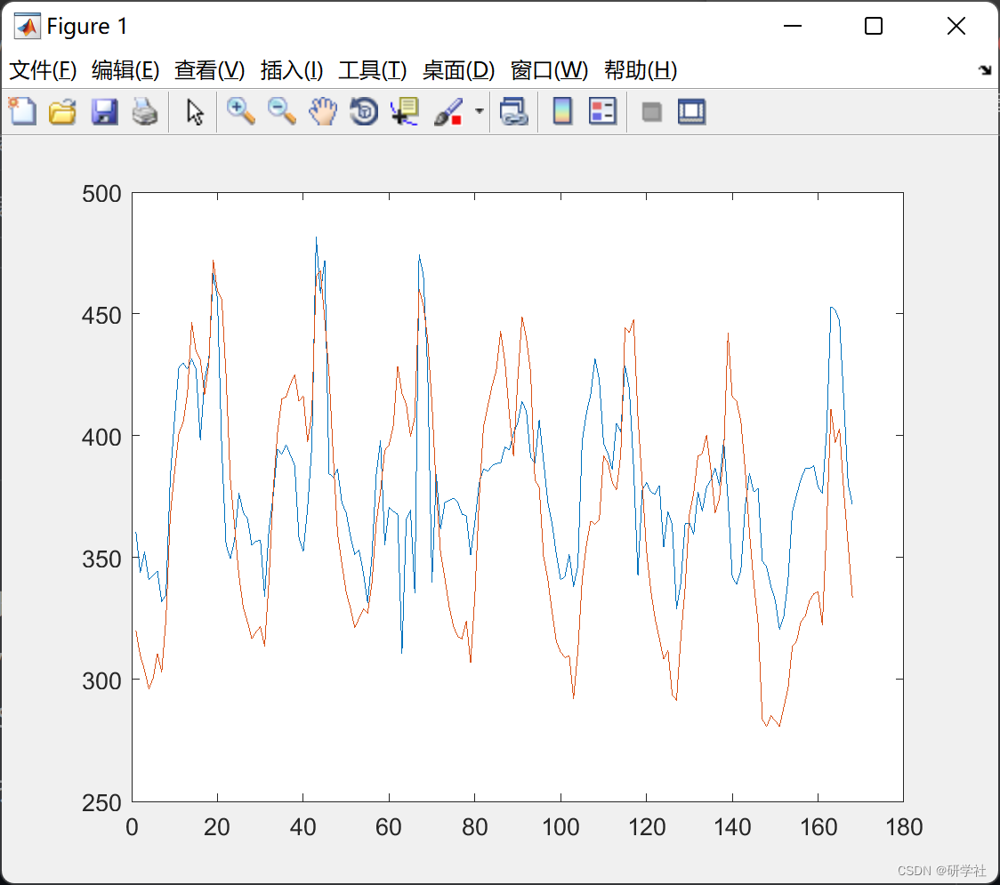
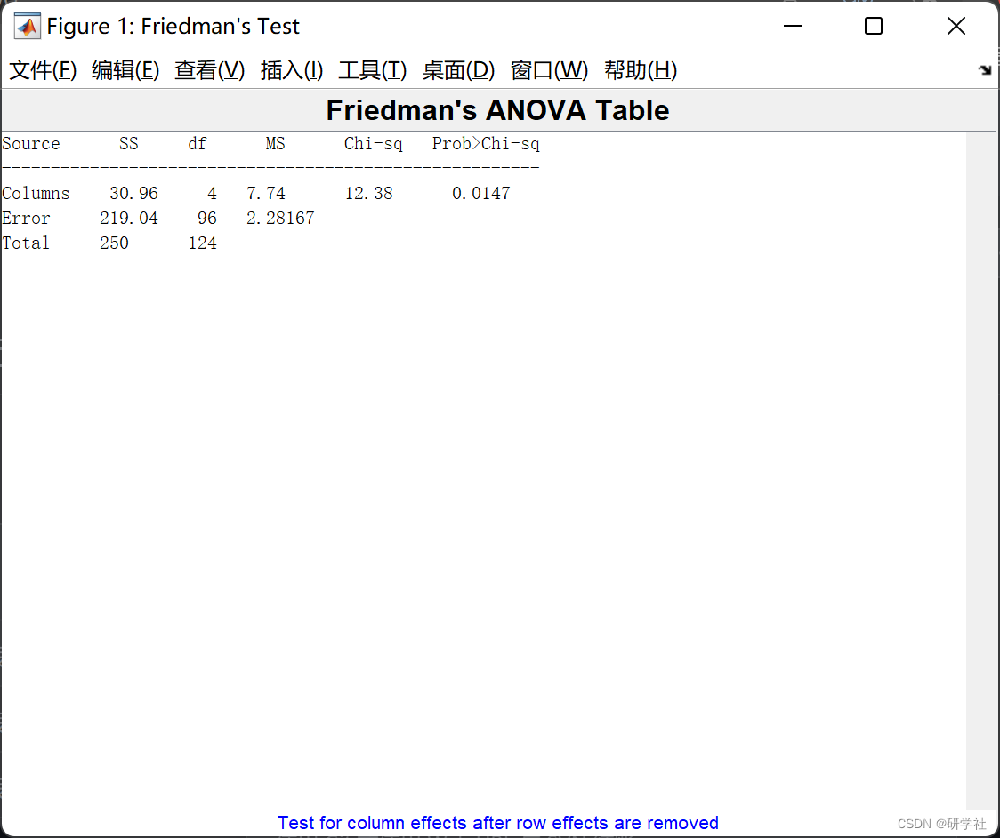

# [Load Forecasting] LS-SVM Optimized by Improved Grey Wolf Optimization (IGWO) for Load Forecasting (Matlab Code Implementation)

🏆 Bloggers' Advantages: 🌞🌞🌞 The content of the blog strives to be rigorous in thought and clear in logic, for the convenience of readers.
⛳️ Mantra: "Those who have traveled a hundred miles may find that half of the journey is yet to be completed." 📜
💥1 Overview Accurate power load forecasting plays a crucial role in the stable operation of the power grid. The magnitude of power load is influenced by various key information: temperature and humidity, wind speed, date type, regional GDP, etc. However, it is generally difficult to obtain accurate data for all key information. Therefore...
If accurate power load forecasting can be implemented even when key information is missing, the process of collecting and processing various data can be simplified, simplifying the steps of power load forecasting.
The research on short-term power load forecasting mainly includes multivariate time series analysis and univariate time series analysis. Multivariate time series analysis takes into account various key information data such as weather.
This paper optimizes the LSSVM with improved Grey Wolf Optimization (IGWO) for load forecasting and implements it in MATLAB.
📚2 Running Results Editing
Editor
Editor
Part of the code:
namafile = {'Hasil Simulasi IGWO 1';  
'Hasil Simulasi IGWO 2';  
'Hasil Simulasi IGWO 3';  
'Hasil Simulasi IGWO 4';  
'Hasil Simulasi IGWO 5';  
'Hasil Simulasi IGWO 6';  
'Hasil Simulasi IGWO 7';  
'Hasil Simulasi IGWO 8';  
'Hasil Simulasi IGWO 9';  
'Hasil Simulasi IGWO 10';  
'Hasil Simulasi IGWO 11';  
};  
% hasilsimulasi = zeros(4,30);  
hasilsimulasi = zeros(8,30);  
for jj = 1:25  
%% I-GWO  
starting = matriksawalhari(jj);  
hasilsimulasi = zeros(8,30);  
for k = 1:30 %% ambil data 30 kali  
%% susun data yang diregress  
barisdata = [];  
%    harilibur = [];  
% weekend = [];  
awalhari = starting;  
panjangdata = 5*7; %%5 minggu -> 4 minggu data forecast + 1 minggu input  
akhirhari = panjangdata+awalhari-1;  
for i = awalhari:akhirhari %%1:35  
barisdata = [barisdata,matriksdata(i,:)];  
%  weekend = [weekend,ones(1,24)*liburdata(i,1)];  
%      harilibur = [harilibur,ones(1,24)*liburdata(i,2)];  
end  
barisdata = barisdata';  
% weekend = weekend';  
%    harilibur = harilibur';  
%% Windowize data  
predictrange = 24*7;  
lagend = 29*24; %%7 hari input+1 output  
lagstep = 24*7;  
datatable = windowize(barisdata,1:lagstep:lagend); %%Y part might be filled by indices  
Xtraindata = datatable(:,1:end-1); %%input training  
Ytraindata = datatable(:,end); %%output training  
skala = 0;  
for ss = 2:168 %% for computing MASE  
skala = skala + abs(Ytraindata(ss) - Ytraindata(ss-1));  
end  
skala = skala/(168-1);  
% datatable = windowize(weekend,1:lagstep:lagend);  
% Xtraindata = [Xtraindata,datatable(:,1)];  
%    datatable = windowize(harilibur,1:lagstep:lagend);  
%    Xtraindata = [Xtraindata,datatable(:,1:end)];  
%% create Xtestdata and Ytestdata  
awalhari = akhirhari-27; %%  
panjangdata = 5*7; %%2 minggu -> 1 input 1 output  
akhirhari = panjangdata+awalhari-1;  
barisdata = [];  
%    harilibur = [];  
% weekend = [];  
for i = awalhari:akhirhari %% 7 dari 7 hari atau 24*7 jam  
barisdata = [barisdata,matriksdata(i,:)];  
%  weekend = [weekend,ones(1,24)*liburdata(i,1)];  
%      harilibur = [harilibur,ones(1,24)*liburdata(i,2)];  
end  
barisdata = barisdata';  
% weekend = weekend';  
%    harilibur = harilibur';  
datatable = windowize(barisdata,1:lagstep:lagend); %%Y part might be filled by indices  
Xtestdata = datatable(:,1:end-1); %%input training  
Ytestdata = datatable(:,end); %%output training  
% datatable = windowize(weekend,1:lagstep:lagend);  
% Xtestdata = [Xtestdata,datatable(:,1)];  
%    datatable = windowize(harilibur,1:lagstep:lagend);  
%    Xtestdata = [Xtestdata,datatable(:,1:end)];  
%% Start 4-fold CV tuning. Error function MAE. Optimization Method Coupled SA then Nelder-Mead Simplex Algorithm  
tic;  
[gam,sig2] = tunelssvmigwo({Xtraindata,Ytraindata,'f',[],[],'RBF_kernel'},'simplex','crossvalidatelssvm',{4,'mae'});  
waktusim = toc;  
%% Get Alpha Beta from best tuning  
[alpha,b] = trainlssvm({Xtraindata,Ytraindata,'f',gam,sig2,'RBF_kernel'});  
%% Start Prediction  
prediction = simlssvm({Xtraindata,Ytraindata,'f',gam,sig2,'RBF_kernel'},{alpha,b},Xtestdata);  
%  plot([prediction Ytestdata]);  
errorMAE = mean(abs(prediction-Ytestdata)); %Forecast error MAE  
errorMAPE = mean(abs(100*(prediction-Ytestdata)./Ytestdata)); %MAPE  
errorMASE = mean(abs((prediction-Ytestdata)./skala)); %error MASE  
[errorR,RPval] = corr(prediction,Ytestdata); %korelasi  
hasilsimulasi(:,k) = [gam;sig2;errorMAE;waktusim;errorMAPE;errorMASE;errorR^2;RPval];  
end  
%  xlswrite(char(namafile(jj)),hasilsimulasi,'GWO','B2');  
xlswrite(char(namafile(jj)),hasilsimulasi,'IGWO','B2');  
% %% GWO  
hasilsimulasi = zeros(8,30);  
for k = 1:30 %% ambil data 30 kali  
%% susun data yang diregress  
barisdata = [];  
%    harilibur = [];  
% weekend = [];  
awalhari = starting;  
panjangdata = 5*7; %%5 minggu -> 4 minggu data forecast + 1 minggu input  
akhirhari = panjangdata+awalhari-1;  
for i = awalhari:akhirhari %%1:35  
barisdata = [barisdata,matriksdata(i,:)];  
%  weekend = [weekend,ones(1,24)*liburdata(i,1)];  
%      harilibur = [harilibur,ones(1,24)*liburdata(i,2)];  
end  
barisdata = barisdata';  
% weekend = weekend';  
%    harilibur = harilibur';  
%% Windowize data  
predictrange = 24*7;  
lagend = 29*24; %%7 hari input+1 output  
lagstep = 24*7;  
datatable = windowize(barisdata,1:lagstep:lagend); %%Y part might be filled by indices  
Xtraindata = datatable(:,1:end-1); %%input training  
Ytraindata = datatable(:,end); %%output training  
skala = 0;  
for ss = 2:168 %% for computing MASE  
skala = skala + abs(Ytraindata(ss) - Ytraindata(ss-1));  
end  
skala = skala/(168-1);  
% datatable = windowize(weekend,1:lagstep:lagend);  
% Xtraindata = [Xtraindata,datatable(:,1)];  
%    datatable = windowize(harilibur,1:lagstep:lagend);  
%    Xtraindata = [Xtraindata,datatable(:,1:end)];  
%% create Xtestdata and Ytestdata  
awalhari = akhirhari-27; %%  
panjangdata = 5*7; %%2 minggu -> 1 input 1 output  
akhirhari = panjangdata+awalhari-1;  
barisdata = [];  
%    harilibur = [];  
% weekend = [];  
for i = awalhari:akhirhari %% 7 dari 7 hari atau 24*7 jam  
barisdata = [barisdata,matriksdata(i,:)];  
%  weekend = [weekend,ones(1,24)*liburdata(i,1)];  
%      harilibur = [harilibur,ones(1,24)*liburdata(i,2)];  
end  
barisdata = barisdata';  
% weekend = weekend';  
%    harilibur = harilibur';  
datatable = windowize(barisdata,1:lagstep:lagend); %%Y part might be filled by indices  
Xtestdata = datatable(:,1:end-1); %%input training  
Ytestdata = datatable(:,end); %%output training  
% datatable = windowize(weekend,1:lagstep:lagend);  
% Xtestdata = [Xtestdata,datatable(:,1)];  
%    datatable = windowize(harilibur,1:lagstep:lagend);  
%    Xtestdata = [Xtestdata,datatable(:,1:end)];  
%% Start 4-fold CV tuning. Error function MAE. Optimization Method Coupled SA then Nelder-Mead Simplex Algorithm  
tic;  
[gam,sig2] = tunelssvmgwo({Xtraindata,Ytraindata,'f',[],[],'RBF_kernel'},'simplex','crossvalidatelssvm',{4,'mae'});  
waktusim = toc;  
%% Get Alpha Beta from best tuning  
[alpha,b] = trainlssvmgwo({Xtraindata,Ytraindata,'f',gam,sig2,'RBF_kernel'});  
%% Start Prediction  
prediction = simlssvm({Xtraindata,Ytraindata,'f',gam,sig2,'RBF_kernel'},{alpha,b},Xtestdata);  
%  plot([prediction Ytestdata]);  
errorMAE = mean(abs(prediction-Ytestdata)); %Forecast error MAE  
errorMAPE = mean(abs(100*(prediction-Ytestdata)./Ytestdata)); %MAPE  
errorMASE = mean(abs((prediction-Ytestdata)./skala)); %error MASE  
[errorR,RPval] = corr(prediction,Ytestdata); %korelasi  
hasilsimulasi(:,k) = [gam;sig2;errorMAE;waktusim;errorMAPE;errorMASE;errorR^2;RPval];  
end  
🎉3 References
[2] Li Wei. Research on regional power load forecasting based on Grey Wolf Optimization Algorithm [D]. Shenyang Agricultural University, 2022. DOI: 10.27327/d.cnki.gshnu.2022.000510.
[3] Yu Junqi, Ni Jikai, Zhao Anjun, Hou Xueyan. Feature Mining-Based ARIMA-GRU Short-Term Electricity Load Forecast [J]. Journal of Power Systems and Automation, 2022, 34(3): 91-99
🌈4 Matlab code implementation

## Images

<!-- PAYMENT_BLOCK -->

## Get this dataset

- Payment link (Stripe): [Buy now](https://buy.stripe.com/3cs8yP7sY87d0vu9AB)
- Payment QR code: 

<!-- /PAYMENT_BLOCK -->
